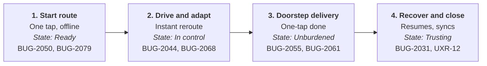

# Future-State Journey Map: Frontline Driver

> **Module 2 · Lab 2.** Journey map artifact referenced from [`competitive-and-journey.md`](competitive-and-journey.md).
> Builds on [`ai-synthesis.md`](ai-synthesis.md) and the Module 1 [`problem-hook.md`](../01-product-thinking/problem-hook.md).

**Persona:** Frontline Driver
**Goal:** Finish the route quickly, logging each delivery in seconds and without backtracking.
**Strategy:** Reclaim operational simplicity by stripping away legacy noise and ensuring the tool is the fastest for everyday work.

## Visual timeline

| | 1. Start route | 2. Drive and adapt | 3. Doorstep delivery | 4. Recover and close |
|---|---|---|---|---|
| **User action** | One tap, offline | Instant reroute | One-tap done | Resumes, syncs |
| **Internal state** | Ready | In control | Unburdened | Trusting |
| **Pain point addressed** | BUG-2050, BUG-2079 | BUG-2044, BUG-2068 | BUG-2055, BUG-2061 | BUG-2031, UXR-12 |

## The 4 stages

1. **Start route**
   - **User action:** Opens the app and taps "Start Route" on the home screen → the route begins instantly.
   - **Internal state:** Stop list already cached offline → a confident start, even with no signal.
   - **Pain point addressed:** Buried start action and blank offline routes → no daily screenshot backup (BUG-2079, BUG-2050, UXR-06).

2. **Drive and adapt**
   - **User action:** Gets a push alert when dispatch reassigns a stop → turns the right way immediately.
   - **Internal state:** The route always matches the dispatcher's plan → in control, no second-guessing.
   - **Pain point addressed:** 8–15 minute reassignment lag and ignored road closures → no WhatsApp check-ins (BUG-2044, BUG-2068).

3. **Doorstep delivery**
   - **User action:** One tap on "Delivered" with a package in hand → the stop closes in seconds.
   - **Internal state:** Photo queued with a visible "saved" tick → unburdened, no retakes.
   - **Pain point addressed:** 3-screen completion and silent upload failures → no texting the dispatcher (BUG-2055, BUG-2061, UXR-01).

4. **Recover and close**
   - **User action:** Reopens the app after a crash → remaining stops reload from the phone.
   - **Internal state:** Data syncs automatically when signal returns → trusting, no paper manifest needed.
   - **Pain point addressed:** Lost routes and calls to the office → the manifest becomes unnecessary (BUG-2031, UXR-03, UXR-12).

## 3 competitive advantages over the manual workaround

1. **One system of record:** Deliveries are logged at the doorstep → the dispatcher's board is accurate, with no WhatsApp group.
2. **Always current:** Live reassignments arrive in the app → paper and screenshots can't update, so they go stale.
3. **No prep or recovery cost:** No daily manifest and no read-aloud office calls → time goes back to driving.
